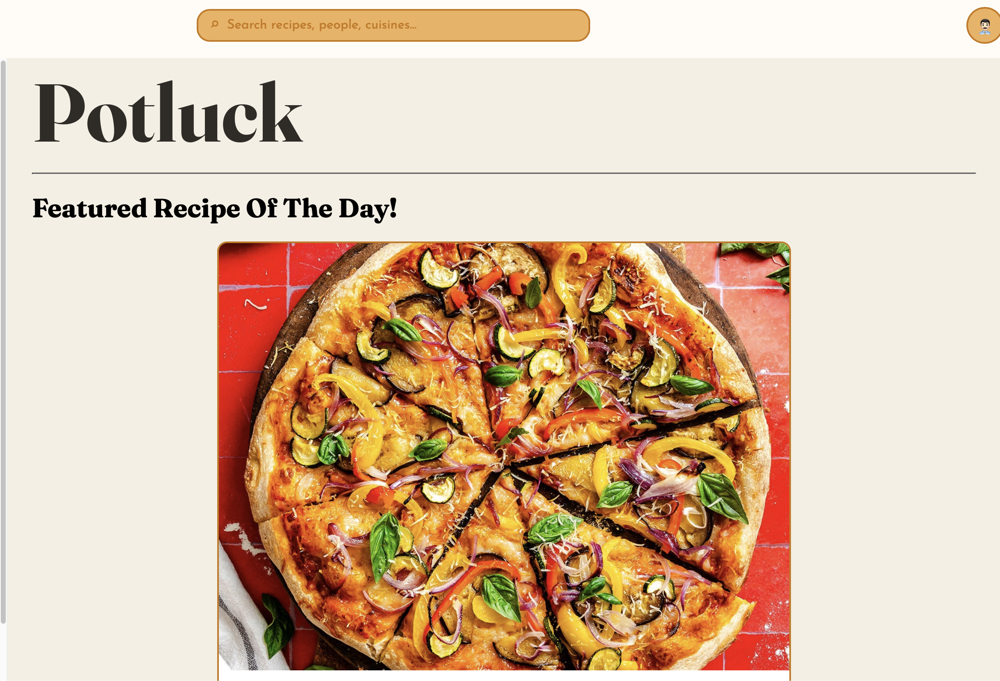
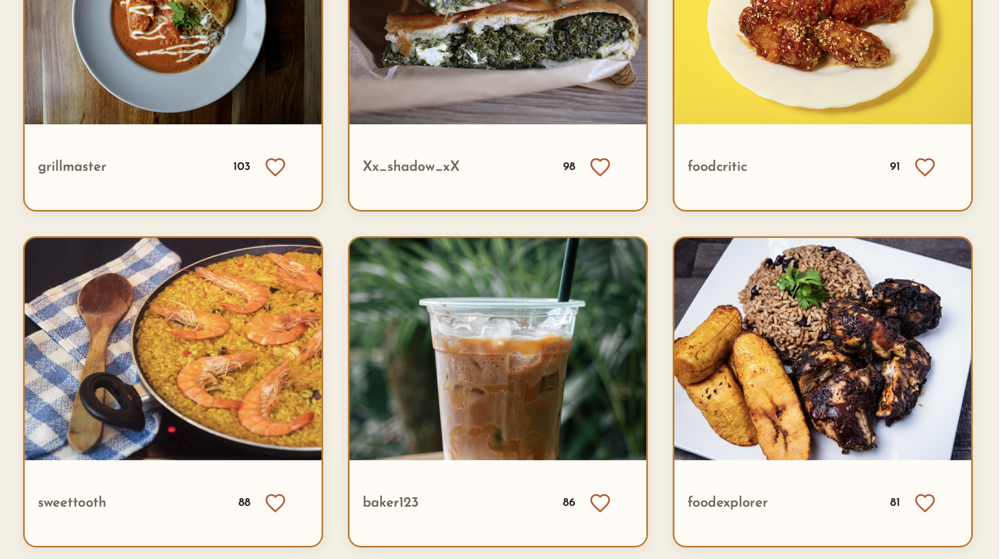
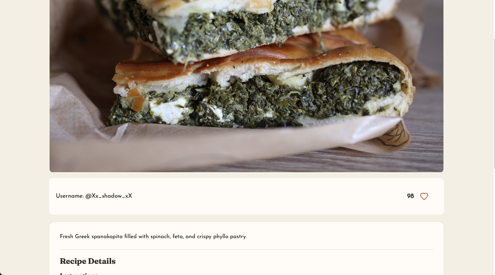

# Potluck

**Many Cultures, One Home!** 

Food is more than just a meal. It's a way to share traditions, celebrate culture, and connect people from around the world.

**Potluck** is a full-stack recipe-sharing social platform designed to bring cultures together through food. Users can discover and share recipes from their cultural backgrounds, explore cuisines from around the world, and connect with others through a shared love of cooking.

Built for the **HACK.COMS Fall 2026 Hackathon** at Rochester Institute of Technology (RIT).

[View the DevPost for Potluck here!](https://devpost.com/software/potluck-ie52t8)

## Features

- **Recipe Sharing:** Share traditional recipes, cooking instructions, and photos with the community.
- **Cultural Discovery:** Explore recipes and cuisines from different cultures around the world.
- **Social Interaction:** Like and save recipes to engage with other users and revisit favorite dishes.
- **Search & Filtering:** Discover recipes through search and filtering options.
- **Multilingual Translation:** Translate recipe content to make cultural recipes more accessible to users around the world.
- **Responsive Interface:** Browse recipes through a modern, user-friendly interface.

## Website

### Homepage

### Recipe Feed

### Recipe Details

## Tech Stack

| Category | Technologies | Purpose |
| --- | --- | --- |
| Frontend | React, JavaScript, CSS | Interactive user interface and recipe feed |
| Backend | Python, FastAPI | RESTful API and application logic |
| Database | PostgreSQL, SQLAlchemy, TigerData | Relational data storage, ORM, and managed PostgreSQL hosting |
| Image Storage | Supabase Storage | Cloud storage and delivery of recipe images |
| Translation | Google Translate | Multilingual recipe translation |
| Web Server | NGINX | Static frontend hosting and reverse proxy routing |
| Containerization | Docker, Docker Compose | Containerized services and multi-container orchestration |
| Cloud Infrastructure | AWS EC2, AWS Elastic IP | Cloud application hosting and static public IP addressing |
| Networking & DNS | Cloudflare | Domain management, DNS configuration, and proxy services |

## Architecture

Potluck uses a containerized full-stack architecture deployed on AWS EC2.

The **React frontend** communicates with a **FastAPI REST API** through an **NGINX reverse proxy**. The backend uses **SQLAlchemy** to interact with a managed **PostgreSQL database hosted on TigerData**, while recipe images are stored separately in **Supabase Storage**.

**Docker Compose** manages the application containers, and **Cloudflare** provides domain management and DNS routing.

This architecture separates the frontend, backend, database, and image storage services, making the application easier to maintain and extend.

## Project Background

Potluck was developed collaboratively during the HACK.COMS Fall 2026 Hackathon at RIT, with the goal of creating a platform that celebrates cultural diversity through food.

Throughout development, our team gained hands-on experience with full-stack application development, cloud deployment, database integration, and DevOps practices.

One of our biggest challenges was managing recipe images alongside structured recipe data. We addressed this by separating image storage from our PostgreSQL database, using Supabase Storage for images and PostgreSQL for application data.

## Future Improvements

We hope to continue developing Potluck beyond the hackathon by expanding its social features, improving recipe discovery, and making the platform more accessible to users from different cultural and linguistic backgrounds.

Our goal is to create a community where everyone can celebrate their heritage and discover new cultures, one recipe at a time.